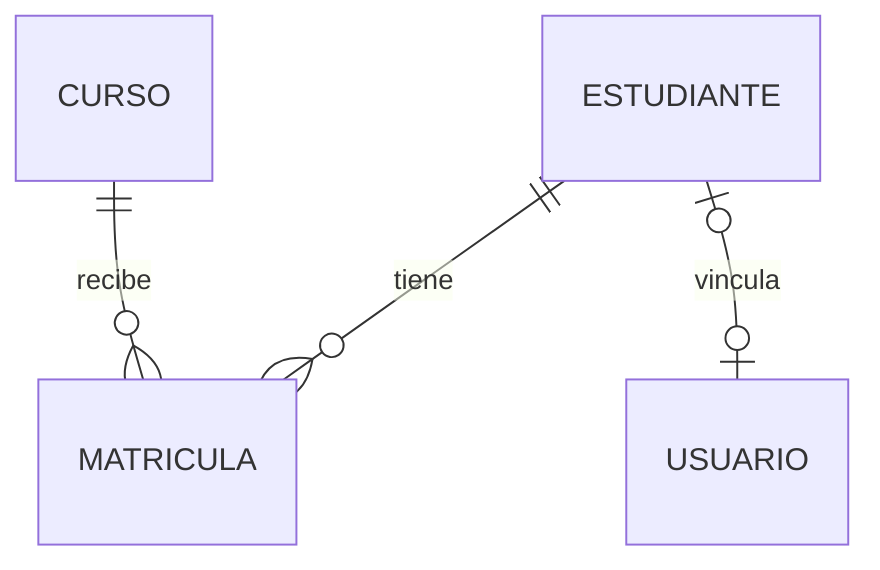

# Laboratorio 2 — parte B

Se amplió el modelo del catálogo con Estudiante, Matricula y Usuario, siguiendo la parte B de Modulo2_Informe_Laboratorio_Alumno.docx. Se añadieron las enumeraciones EstadoMatricula (ACTIVA y RETIRADA) y Rol (ADMIN, DOCENTE y ESTUDIANTE).

## Relaciones

Matricula es la dueña de sus dos relaciones @ManyToOne LAZY porque contiene las claves foráneas. Su tabla guarda fecha y estado e impide duplicar estudiante_id y curso_id. Curso y Estudiante exponen listas inversas con mappedBy. No se usan cascadas de borrado que eliminen matrículas automáticamente.

Usuario tiene username único, campo para el hash de contraseña, rol y una relación opcional @OneToOne con Estudiante. La unicidad de estudiante_id impide vincular dos cuentas al mismo estudiante. La entidad recibe un hash; la codificación de las contraseñas de usuarios reales se implementará en la parte de seguridad. La prueba de persistencia utiliza BCrypt con una contraseña sintética.

Curso incorpora @Version y un getter de lectura para comprobar su evolución. Hibernate incrementa la versión al actualizar y rechaza una entidad con versión obsoleta. Esta protección no equivale al bloqueo del último cupo, que se implementará con el servicio de matrículas.

## Actualización de PostgreSQL existente

Antes del cambio se guardó un respaldo en la carpeta de outputs respaldo-laboratorio-2/antes-parte-b.dump. No se realizó una restauración de prueba.

Se aplicó db/laboratorio2/01_inicializar_version.sql: añade la columna version si no existe e inicializa a cero los cursos previos. La transacción no cambia campos del catálogo ni identificadores. Esto evita arrancar @Version con valores nulos en registros del Laboratorio 1. Hibernate creó las tablas nuevas y sus restricciones con el perfil postgres.

## Verificación

| Comprobación | H2 | PostgreSQL |
|---|---|---|
| Batería completa | 26 pruebas, 0 fallos | 26 pruebas, 0 fallos |
| Relaciones y estados persistidos | Correcto | Correcto |
| Carga diferida de las relaciones de matrícula | Correcto | Correcto |
| Matrícula duplicada | Rechazada por restricción | Rechazada por restricción |
| Dos usuarios para el mismo estudiante | Rechazado por restricción | Rechazado por restricción |
| Referencias a estudiante/curso inexistentes | Rechazadas | Rechazadas |
| Edición con versión obsoleta | Rechazada | Rechazada |

Las siete pruebas nuevas del modelo usan transacciones que se revierten. Las tablas estudiantes, matriculas y usuarios quedan vacías; no se insertaron cuentas reales. Los cursos originales se compararon antes y después, conservando todos sus datos e identificadores. La nueva columna version quedó inicializada en cero.

El caso de versión obsoleta es una prueba de persistencia dentro de una transacción; no se presenta como una prueba de dos peticiones HTTP simultáneas. Las pruebas provocan violaciones de restricciones de forma deliberada; esos errores aparecen en los logs y el resultado final de la batería es correcto.

Archivos: pruebas-h2.txt, pruebas-postgres.txt, actualizacion-version.txt, esquema-postgresql.txt y verificacion.json. Se omitieron las contraseñas temporales generadas automáticamente por Spring Security.

## Siguiente parte

Parte C: repositorios, consultas, paginación y servicios. Login y autorización JWT continúan pendientes para la parte E. El acceso HTTP mantiene la protección predeterminada provisional.
